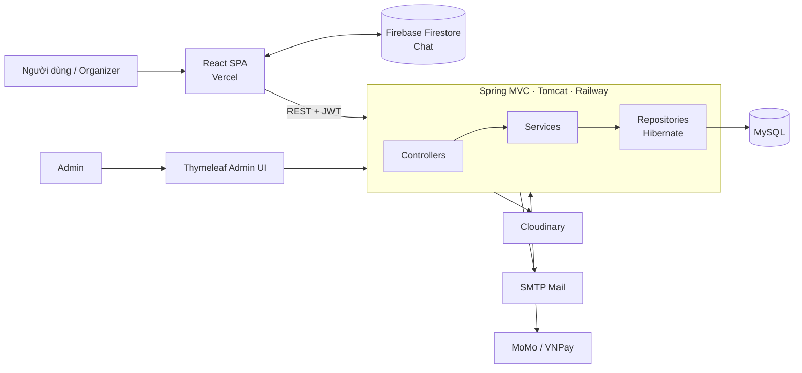
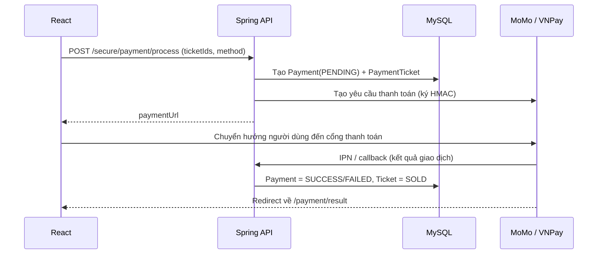
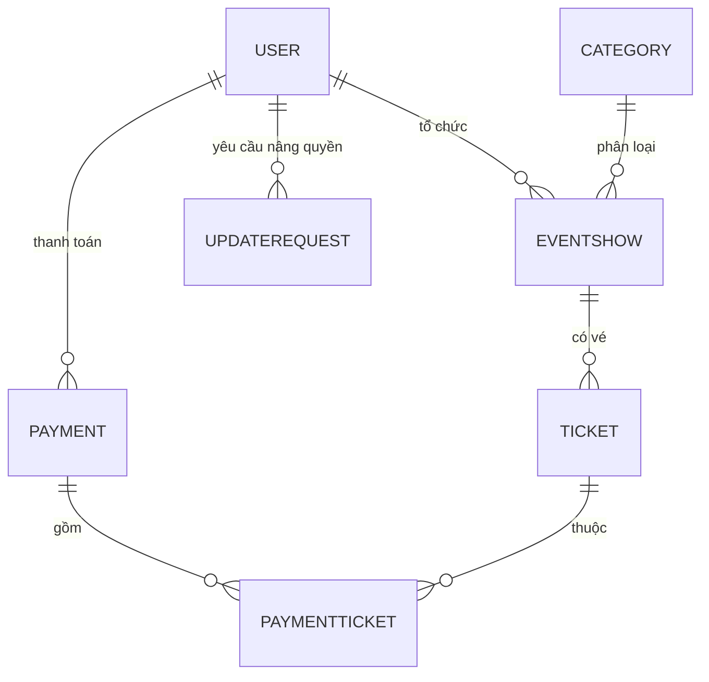

# 🎫 TicketHub — Nền tảng bán vé sự kiện trực tuyến

> Ứng dụng full-stack cho phép người dùng khám phá sự kiện, mua vé và thanh toán qua **MoMo / VNPay**; ban tổ chức tự đăng sự kiện và theo dõi doanh thu; quản trị viên duyệt quyền tổ chức.

| | |
|---|---|
| **Demo (Frontend)** | https://spring-ticket-sale-eight.vercel.app |
| **API (Backend)** | https://springticketsale-production.up.railway.app/TicketSale/api/events |
| **Source code** | https://github.com/HieuLT24/SpringTicketSale |
| 

> ⚠️ Backend chạy trên gói miễn phí nên lần gọi đầu tiên có thể chậm vài giây do server "ngủ đông".

---

## 1. Bài toán & mục tiêu

Người dùng thường phải mua vé qua nhiều kênh rời rạc, còn ban tổ chức nhỏ thiếu công cụ để bán vé và nhìn thấy doanh thu. TicketHub gom toàn bộ luồng đó vào một nơi:

- **Khách / Người dùng**: tìm kiếm sự kiện, chọn vé, thanh toán online, xem lại vé đã mua, nhắn tin trực tiếp với ban tổ chức.
- **Ban tổ chức (Organizer)**: tạo/sửa/xóa sự kiện, xem số vé đã bán và thống kê doanh thu theo tháng / quý / năm.
- **Quản trị viên (Admin)**: xem dashboard tổng quan và duyệt yêu cầu nâng cấp lên Organizer.

---

## 2. Điểm nhấn kỹ thuật

### 💳 Tích hợp cổng thanh toán thật (MoMo & VNPay)
- Tự xây dựng chuỗi dữ liệu và ký **HMAC-SHA256 (MoMo)** và **HMAC-SHA512 (VNPay)** theo tài liệu của từng cổng, không dùng thư viện bọc sẵn.
- Xử lý đủ vòng đời: tạo đơn `PENDING` → sinh URL thanh toán → nhận **IPN / return callback** → cập nhật đơn `SUCCESS/FAILED` và chuyển vé sang `SOLD`.
- Callback VNPay được **xác thực chữ ký** trước khi cập nhật trạng thái đơn hàng.
- Mỗi đơn có mã giao dịch riêng, lưu lịch sử thanh toán và danh sách vé của từng người dùng.

### 🔐 Xác thực & phân quyền
- **JWT stateless**: filter riêng kiểm tra Bearer token cho toàn bộ `/api/secure/**`.
- Mật khẩu băm bằng **BCrypt**; đăng nhập bằng **Google OAuth2** (xác minh ID token và kiểm tra `aud`).
- Quên / đặt lại mật khẩu qua **email (JavaMail)** bằng link có thời hạn.
- Khu vực quản trị `/admin/**` dùng **form login + `ROLE_ADMIN`** của Spring Security, tách biệt với luồng API JWT.
- Kiểm tra **quyền sở hữu** ở tầng service: organizer chỉ sửa/xóa được sự kiện của mình và chỉ xem được doanh thu của sự kiện mình.

### 📊 Thống kê doanh thu cho Organizer
- Truy vấn bằng **Hibernate Criteria API**: join nhiều bảng (`Payment → PaymentTicket → Ticket → EventShow`), `GROUP BY` theo tháng / quý / năm, lọc theo organizer và trạng thái `SUCCESS`.
- Giao diện React hiển thị tổng quan doanh thu, số vé bán và chi tiết từng sự kiện.

### 💬 Chat thời gian thực
- Người mua nhắn tin trực tiếp với ban tổ chức ngay trên trang sự kiện, dùng **Firebase Firestore** (`onSnapshot`) để đồng bộ tức thì.

### 🔎 Tìm kiếm & phân trang sự kiện
- Lọc theo từ khóa (tên / mô tả), khoảng giá, danh mục; sắp xếp động; phân trang phía server (9 sự kiện/trang).

### 🛡️ Quy trình nâng quyền có kiểm duyệt
- User gửi yêu cầu → Admin duyệt/từ chối trên dashboard Thymeleaf → hệ thống tự nâng role thành `ORGANIZER`.

### 🚀 Triển khai & cấu hình
- **Docker multi-stage** (Maven build → Tomcat 10.1 / JDK 17) cho backend.
- Backend deploy trên **Railway**, frontend trên **Vercel**, ảnh lưu trên **Cloudinary**.
- Toàn bộ thông tin nhạy cảm (DB, JWT secret, khóa MoMo/VNPay, mail, Cloudinary) được **đọc từ biến môi trường**, không commit vào repo.

---

## 3. Công nghệ sử dụng

| Tầng | Công nghệ |
|---|---|
| **Backend** | Java 17, **Spring MVC 6.2** (cấu hình bằng Java, đóng gói WAR chạy trên Tomcat), **Spring Security 6.5**, **Hibernate ORM 7.1** (Criteria API), Thymeleaf (trang Admin), Spring Boot Mail/Thymeleaf starters |
| **Bảo mật** | JWT (jjwt), BCrypt, Google Sign-In, Nimbus JOSE |
| **CSDL** | MySQL 8 |
| **Frontend** | React 19, React Router 7, React Bootstrap, Axios, `@react-oauth/google` |
| **Dịch vụ ngoài** | MoMo (sandbox), VNPay (sandbox), Firebase Firestore, Cloudinary, SMTP (Gmail) |
| **DevOps** | Maven, Docker (multi-stage), Railway, Vercel |

---

## 4. Kiến trúc hệ thống



Backend tổ chức theo mô hình phân tầng rõ ràng: `controllers` → `services` (interface + `impl`) → `repositories` (interface + `impl`) → `pojo` (entity), kèm `dto`, `filter`, `configs`, `utils`.

### Luồng thanh toán



### Mô hình dữ liệu



---

## 5. Tính năng chính

**Người dùng**
- Xem / tìm kiếm / lọc sự kiện theo danh mục, giá, từ khóa
- Đăng ký, đăng nhập (tài khoản hoặc Google), quên & đặt lại mật khẩu
- Mua vé, thanh toán MoMo hoặc VNPay, xem lịch sử đơn và "Vé của tôi"
- Cập nhật hồ sơ (kèm ảnh đại diện), đổi mật khẩu
- Chat với ban tổ chức

**Ban tổ chức**
- Gửi yêu cầu trở thành Organizer
- Tạo / sửa / xóa sự kiện, upload banner
- Xem vé đã bán và doanh thu từng sự kiện
- Thống kê doanh thu theo tháng, quý, năm, tổng quan

**Quản trị viên**
- Dashboard: tổng người dùng, sự kiện, vé đã bán, doanh thu
- Duyệt / từ chối yêu cầu nâng cấp Organizer

---

## 6. Chạy dự án trên máy

**Yêu cầu:** Java 17+, Maven 3.8+, Node.js 18+, MySQL 8+, Docker (tuỳ chọn)

```bash
git clone https://github.com/HieuLT24/SpringTicketSale.git
cd SpringTicketSale
```

**Backend** — khai báo các biến môi trường:

| Nhóm | Biến |
|---|---|
| Database | `TOMCAT_DATASOURCE_URL`, `TOMCAT_DATASOURCE_USERNAME`, `TOMCAT_DATASOURCE_PASSWORD` |
| JWT | `JWT_SECRET`, `JWT_EXPIRATION` |
| MoMo | `MOMO_PARTNER_CODE`, `MOMO_ACCESS_KEY`, `MOMO_SECRET_KEY`, `MOMO_ENDPOINT`, `MOMO_REDIRECT_URL`, `MOMO_IPN_URL` |
| VNPay | `VNPAY_TMN_CODE`, `VNPAY_HASH_SECRET`, `VNPAY_URL`, `VNPAY_RETURN_URL` |
| Mail | `SPRING_MAIL_HOST`, `SPRING_MAIL_PORT`, `SPRING_MAIL_USERNAME`, `SPRING_MAIL_PASSWORD` |
| Cloudinary | `CLOUDINARY_CLOUD_NAME`, `CLOUDINARY_API_KEY`, `CLOUDINARY_API_SECRET` |
| Khác | `FRONTEND_BASE_URL` (+ Google Client ID trong `google-auth.properties`) |

```bash
# Chạy bằng Docker
cd TicketSale
docker build -t tickethub-api .
docker run -p 8080:8080 --env-file .env tickethub-api
# API: http://localhost:8080/TicketSale/api/
```

**Frontend**

```bash
cd ticketweb
npm install
# Đổi BASE_URL trong src/configs/Apis.js sang http://localhost:8080/TicketSale/api/
# Điền cấu hình Firebase trong src/configs/Firebase.js
npm start   # http://localhost:3000
```

---

## 7. API tiêu biểu

| Nhóm | Endpoint | Ghi chú |
|---|---|---|
| Public | `GET /events`, `GET /events/{id}`, `GET /categories` | Hỗ trợ `kw`, `fromPrice`, `toPrice`, `cateId`, `orderBy`, `page` |
| Auth | `POST /login`, `POST /register`, `POST /login/google` | Trả về JWT |
| Auth | `POST /forgot-password`, `POST /reset-password` | Qua email |
| Thanh toán | `POST /secure/payment/process` | Trả về `paymentUrl` |
| Thanh toán | `POST /secure/payment/callback/momo/ipn`, `GET\|POST /secure/payment/callback/vnpay` | Callback từ cổng |
| Thanh toán | `GET /secure/payment/my`, `GET /secure/payment/my/tickets` | Lịch sử & vé đã mua |
| Organizer | `GET\|POST\|PUT\|DELETE /secure/myEvents` | Quản lý sự kiện |
| Organizer | `GET /secure/revenue/{monthly\|quarterly\|yearly\|overall}` | Thống kê doanh thu |

---

## 8. Hướng phát triển tiếp theo

Những hạng mục mình đã xác định và dự định cải thiện để sản phẩm tiến gần mức production:

- **Chống bán trùng vé**: giữ chỗ vé có thời hạn khi tạo đơn và khóa lạc quan/bi quan khi xác nhận thanh toán.
- **Củng cố thanh toán**: xác thực chữ ký cho IPN của MoMo, đối chiếu số tiền với giá vé ở server, bảo đảm callback idempotent.
- **Phân quyền chặt hơn**: đưa role vào JWT claims và dùng `@PreAuthorize`; tách loại token đặt lại mật khẩu khỏi token đăng nhập; kiểm tra chủ sở hữu khi xem chi tiết đơn.
- **Kiểm thử**: viết unit test cho service và integration test cho luồng thanh toán.
- **CI/CD**: GitHub Actions để build, test và deploy tự động.
- **Chất lượng mã**: chuẩn hóa xử lý lỗi (`@ControllerAdvice`), bỏ `System.out`, thêm validation cho request.

---